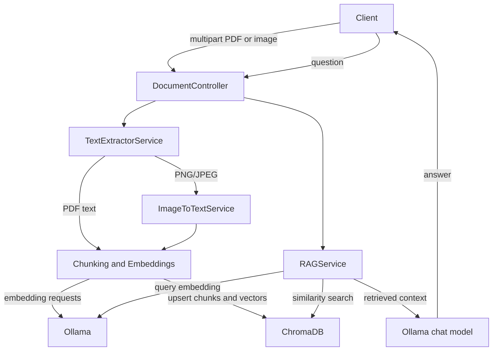

# PDF Tool

A Spring Boot backend for extracting text from PDFs and images, indexing text in ChromaDB, and answering questions over indexed content with a local Ollama model.

## What it does

- Extracts embedded text from text-based PDF files with Apache PDFBox.
- Runs OCR on PNG and JPEG images using OpenCV preprocessing and Tesseract.
- Splits extracted text into overlapping chunks and generates embeddings with Ollama.
- Stores document chunks in ChromaDB.
- Retrieves relevant chunks and passes them to an Ollama chat model to generate an answer.

**Current limitation:** scanned PDFs do not yet go through OCR. PDF extraction currently reads the PDF text layer. Image OCR is supported for standalone PNG/JPEG uploads.

## Architecture



## Technology

- Java 21 and Spring Boot 3.4.3
- Apache PDFBox for PDF text extraction
- OpenCV and Tess4J/Tesseract for image OCR
- Ollama for embeddings and chat completion
- ChromaDB for vector storage
- Maven for dependency and build management

## Prerequisites

- JDK 21
- Docker and Docker Compose (for ChromaDB and Ollama)
- Tesseract OCR installed locally, including its English language data
- OpenCV native library available to the Java runtime

The OpenCV Java dependency is included in Maven. Native library loading is platform-dependent; if the application cannot load OpenCV, install/configure the matching native library for your operating system.

## Run locally

### 1. Clone and enter the repository

```bash
git clone https://github.com/Victory0007/Pdf_Tool.git
cd Pdf_Tool
```

### 2. Start Ollama and ChromaDB

```bash
docker compose up -d
```

Pull the models used by the default configuration:

```bash
docker exec -it pdf-tool-ollama ollama pull llama3.1
docker exec -it pdf-tool-ollama ollama pull nomic-embed-text
```

The first model is used for answer generation; the second generates document and query embeddings.

### 3. Configure OCR

Install Tesseract and ensure its English language data is available. If Tesseract cannot locate its data automatically, set `TESSDATA_PATH` to the directory containing the `eng.traineddata` file.

### 4. Build and run

```bash
./mvnw clean test
./mvnw spring-boot:run
```

The API listens on `http://localhost:8080`.

## API

### Ingest a document

`POST /pdfTool/documents`

Content type: `multipart/form-data`

Form field: `file`

Supported extensions: `.pdf`, `.png`, `.jpg`, `.jpeg`.

Example:

```bash
curl -X POST http://localhost:8080/pdfTool/documents \
  -F "file=@./sample.pdf"
```

The endpoint extracts and indexes the document before returning a success response. Ingestion requires Ollama and ChromaDB to be running.

### Ask a question

`POST /pdfTool/query`

Content type: `text/plain`

Body: the question to ask about indexed documents.

Example:

```bash
curl -X POST http://localhost:8080/pdfTool/query \
  -H "Content-Type: text/plain" \
  --data "What are the main points in the document?"
```

The query endpoint searches the existing knowledge base; it does not re-ingest a document.

## Configuration

Defaults are defined in `src/main/resources/application.properties`. Override them with environment variables:

| Variable | Default | Purpose |
|---|---|---|
| `CHROMA_URL` | `http://localhost:8000` | ChromaDB base URL |
| `OLLAMA_URL` | `http://localhost:11434` | Ollama base URL |
| `OLLAMA_CHAT_MODEL` | `llama3.1` | Chat model |
| `OLLAMA_EMBEDDING_MODEL` | `nomic-embed-text` | Embedding model |
| `OLLAMA_TIMEOUT` | `PT5M` | Chat request timeout |
| `TESSDATA_PATH` | Tesseract default | Optional Tesseract data directory |

## Tests

Run the automated test suite with:

```bash
./mvnw test
```

The unit tests cover text chunking, chunk configuration validation, supported image extension routing, missing files, and unsupported file types. Tests do not require a running Ollama or ChromaDB instance.

## Current scope and next improvements

This project currently uses a single shared ChromaDB collection named `knowledge-base`. It does not yet provide per-user or per-document access control, document deletion, source-page citations, or OCR fallback for scanned PDFs. Those are separate capabilities that would need to be designed and tested before using the service with sensitive or multi-user data.
